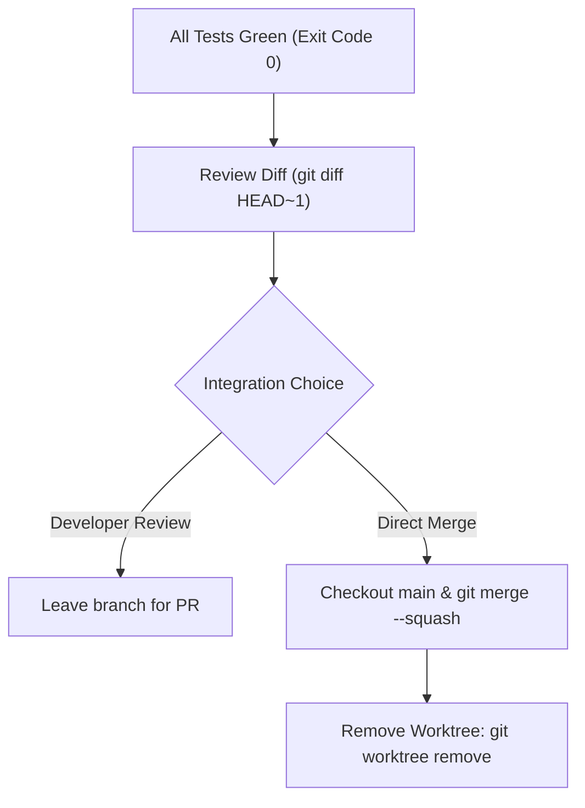

# Git Worktree Isolation & Subagent Safety

Universal procedures for executing multi-file feature development, large refactoring, and subagent tasks in isolated workspaces without corrupting the active working tree.

---

## 1. Core Principle

**Never contaminate the developer's active workspace.**
When starting significant feature development, breaking architectural refactors, or dispatching autonomous subagents:
1. Detect whether isolation already exists.
2. Prefer host-native workspace isolation tools (`Workspace: 'branch'`).
3. Fall back to manual `git worktree` when no native harness is provided.
4. Verify baseline before touching code; clean up on completion.

---

## 2. Step 0: Detect Existing Isolation

Before creating a new workspace, verify whether you are already running in an isolated environment:

```bash
GIT_DIR=$(cd "$(git rev-parse --git-dir)" 2>/dev/null && pwd -P)
GIT_COMMON=$(cd "$(git rev-parse --git-common-dir)" 2>/dev/null && pwd -P)
```

### Submodule Guard
`GIT_DIR != GIT_COMMON` can also occur inside Git submodules. Confirm you are not in a submodule:
```bash
git rev-parse --show-superproject-working-tree 2>/dev/null
```

- **If `GIT_DIR != GIT_COMMON` (and not a submodule):** You are already in a linked worktree. Do NOT create another worktree. Proceed directly to baseline verification.
- **If `GIT_DIR == GIT_COMMON` (or in a submodule):** You are in a normal repository checkout. Proceed to Step 1.

---

## 3. Step 1: Establish Workspace Isolation

### Path A: Subagent Dispatch (Host-Native Harness)
When dispatching a subagent via `invoke_subagent`:
- Specify `Workspace: 'branch'` to provide an isolated copy of the repository.
- Subagents execute changes and tests within their sandbox.

### Path B: Git Worktree Fallback
When executing directly in the terminal or IDE for tasks touching $\ge 3$ files:

1. **Ask Developer Consent:**
   > "Would you like me to set up an isolated worktree (`.worktrees/<feature-name>`) to keep your active branch clean?"
   *(Skip prompt if developer explicitly requested worktree or instructed autonomous execution).*

2. **Select Worktree Directory:**
   Priority order:
   - Hidden local directory: `.worktrees/<feature-name>` (preferred; add `.worktrees/` to `.gitignore` if untracked).
   - Sibling directory: `../<repo>-<feature-name>`

3. **Create the Worktree:**
   ```bash
   git worktree add -b "feature/<feature-name>" ".worktrees/<feature-name>" HEAD
   cd ".worktrees/<feature-name>"
   ```

---

## 4. Step 2: Baseline Verification

Before writing any new code:
1. Run the project's existing test suite (`npm test`, `pytest`, `cargo test`, `go test ./...`).
2. Verify exit code 0.
3. If baseline tests fail *before* your changes, report the existing failures immediately. Do not build on broken foundations.

---

## 5. Step 3: Verification & Clean Integration

When work is complete and all tests pass (Iron Law: exit code 0):



1. **Verification**: Confirm fresh passing test run.
2. **Present Diff Summary**: Report modified files and test evidence.
3. **Cleanup**:
   ```bash
   cd /path/to/main/repo
   git worktree remove ".worktrees/<feature-name>"
   ```

